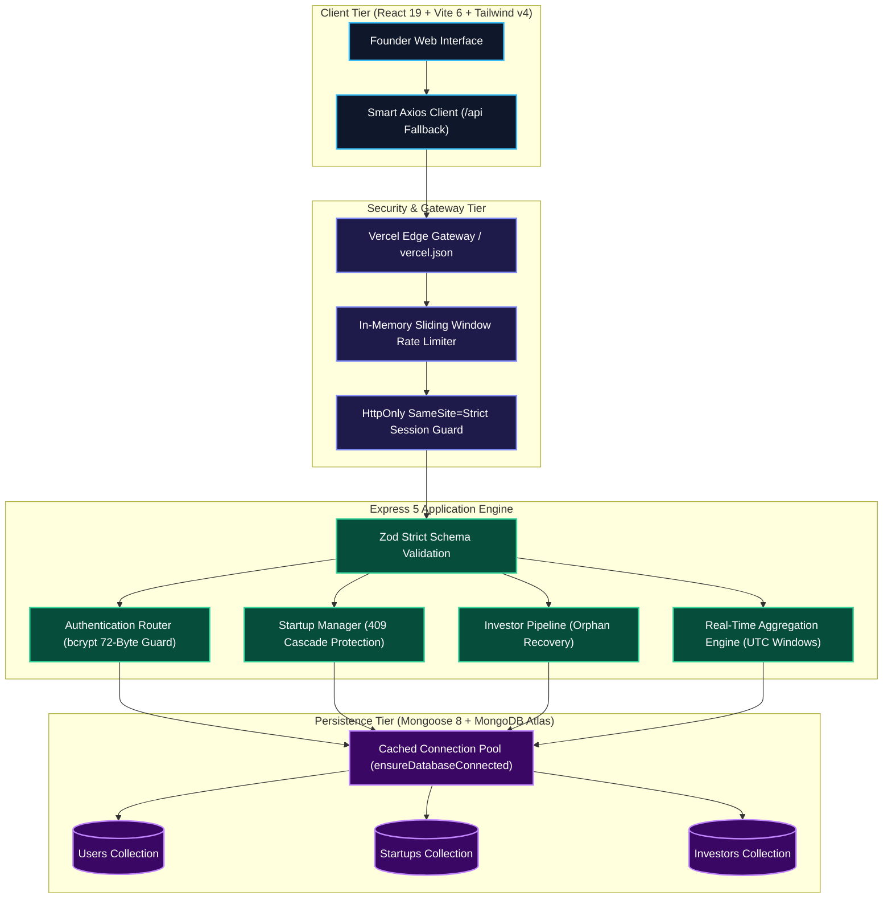

<div align="center">

# ✦ FundFlow ✦
### *The Ethereal Operating System for Startup Capital & Investor Pipelines*

[](LICENSE)
[](https://vitest.dev)
[](https://react.dev)
[](https://expressjs.com)
[](https://vitejs.dev)
[](https://vercel.com)
[](https://github.com)

<p align="center">
  <b>Where capital velocity meets architectural serenity.</b><br>
  FundFlow orchestrates the entire fundraising lifecycle for high-growth founders: transforming chaotic investor outreach into a structured, real-time analytics engine guarded by strict multi-tenant isolation, bulletproof concurrency defenses, and seamless cloud serverless scalability.
</p>

[Explore Features](#-key-features) • [System Architecture](#-architectural-blueprint) • [Quickstart Guide](#-setup--installation-instructions) • [Code0 AI Experience](#-ai-development-experience-with-code0) • [API Specification](#-api-specification)

---

</div>

## ❖ Overview & Philosophy

In the crucible of venture building, momentum is everything. **FundFlow** provides founders with a tranquil, crystal-clear sanctuary to manage investor relationships, capital commitments, and follow-up schedules with effortless precision.

Built as an npm workspaces monorepo, FundFlow balances the reactivity of modern Single Page Applications with the enterprise resilience of a security-hardened backend:
* **The Client**: A fluid, accessible React 19 interface rendered at the speed of thought via Vite 6 and styled with Tailwind CSS v4.
* **The Core**: An Express 5 service enforcing strict schema-level authorization, IETF-compliant rate limiting, and defensive data recovery.
* **The Ledger**: A MongoDB / MongoDB Atlas persistence tier driven by high-performance aggregation pipelines and standalone race condition mitigations.
* **The Cloud**: Native serverless execution via pooled Mongoose connection caching on Vercel Edge.

---

## ◈ Architectural Blueprint



---

## ✦ Key Features

### 1. Multi-Tenant Portfolio Sovereign Isolation
* **Zero Boundary Bleed**: Every startup and investor record is strictly bound to `owner: request.auth.userId`. Cross-tenant queries automatically fail closed, eliminating Insecure Direct Object Reference (IDOR) vulnerabilities.
* **Comprehensive Company Profiles**: Track funding targets, capital secured, pitch links, industry categories, and narrative descriptions in a unified workspace.

### 2. High-Fidelity Investor Relationship Management (CRM)
* **Status Lifecycle**: Navigate investors across 5 standardized stages: `potential` ➔ `contacted` ➔ `meeting_scheduled` ➔ `committed` ➔ `passed`.
* **Temporal Follow-Up Radar**: Intelligent UTC date-boundary calculations classify active touchpoints into **Overdue** (immediate action required), **Due Today** (active priorities), and **Upcoming** (next 7 days).

### 3. Real-Time Aggregation Engine
* **Instant Financial Health**: High-speed MongoDB aggregation pipelines compute aggregate funding goals, capital raised, percent completion progress bars, and status counts with sub-millisecond query execution.
* **Dynamic Pipeline Breakdown**: Visual distribution matrices detailing conversion health across your investor network.

### 4. Hardened Security Fortress
* **Fortified Cookie Transport**: Eliminates localStorage token-theft vectors by transmitting JSON Web Tokens exclusively via `HttpOnly`, `SameSite=Strict`, `Secure` cookies.
* **Sliding-Window Rate Limiting**: Bespoke in-memory rate limiting middleware on `/api/auth/register` and `/api/auth/login` returning standardized `RateLimit-Limit`, `RateLimit-Remaining`, `RateLimit-Reset`, and `Retry-After` headers.
* **Reverse Proxy Trust**: Full compatibility with reverse proxies (`trust proxy`), ensuring accurate client IP extraction without spoofing.
* **Password Boundary Defense**: Strict validation enforcing `Buffer.byteLength(password, 'utf8') <= 72`, neutralizing bcrypt's silent password truncation hazards.

### 5. Resilient Concurrency & Orphan Recovery
* **TOCTOU Race Dual-Guards**: Guarantees referential consistency on standalone MongoDB without requiring distributed locking or replica-set transactions.
* **Decoupled Data Recovery**: Owners can safely prune orphaned investor records even if the parent startup has ceased to exist, maintaining clean records without compromising authorization.

### 6. Cloud Native & Serverless Ready
* **Vercel Serverless Function**: Instant, zero-config deployment via `vercel.json` and `api/index.js` featuring intelligent Mongoose connection caching to eliminate cold-start connection storms.

---

## ❖ Technologies Used

FundFlow is constructed upon a modern, zero-bloat technology stack:

```
┌─────────────────────────────────────────────────────────────────────────────────────────────────┐
│                                       TECHNOLOGY MATRIX                                         │
├─────────────────────┬─────────────────────────────────────┬─────────────────────────────────────┤
│ Ecosystem           │ Technology                          │ Role & Implementation               │
├─────────────────────┼─────────────────────────────────────┼─────────────────────────────────────┤
│ Frontend UI         │ React 19.1                          │ Concurrent rendering & UI state     │
│                     │ Vite 6.4                            │ Next-gen HMR bundler                │
│                     │ Tailwind CSS v4                     │ Design tokens & fluid layout        │
│                     │ React Router 7                      │ Declarative client routing          │
│                     │ Axios 1.8                           │ Credentialed API HTTP transport     │
├─────────────────────┼─────────────────────────────────────┼─────────────────────────────────────┤
│ Backend Service     │ Node.js 20.19+                      │ ECMAScript Modules runtime          │
│                     │ Express 5.1                         │ High-throughput HTTP API router     │
│                     │ Mongoose 8.18                       │ Schema modeling & indexing engine   │
├─────────────────────┼─────────────────────────────────────┼─────────────────────────────────────┤
│ Database            │ MongoDB Atlas                       │ Production multi-tenant database    │
│                     │ mongodb-memory-server 10.2          │ Isolated in-memory test databases   │
├─────────────────────┼─────────────────────────────────────┼─────────────────────────────────────┤
│ Validation & Auth   │ Zod 3.25                            │ Type-safe runtime schema parsing    │
│                     │ jsonwebtoken 9.0                    │ Signed cryptographically safe JWTs  │
│                     │ bcryptjs 3.0                        │ Salted iterative password hashing   │
│                     │ Helmet 8.1                          │ Strict security HTTP header policy  │
│                     │ Cookie-Parser 1.4                   │ Secure signed cookie extraction     │
├─────────────────────┼─────────────────────────────────────┼─────────────────────────────────────┤
│ Quality & Testing   │ Vitest 5.0                          │ Fast multi-threaded test runner     │
│                     │ Supertest 7.1                       │ Declarative HTTP endpoint assertions│
│                     │ React Testing Library 16.3          │ Behavioral user-centric testing     │
├─────────────────────┼─────────────────────────────────────┼─────────────────────────────────────┤
│ Deployment          │ Vercel Serverless Functions         │ Global edge compute & serverless    │
│                     │ Vercel Edge Network                 │ High-speed static SPA distribution  │
└─────────────────────┴─────────────────────────────────────┴─────────────────────────────────────┘
```

---

## ◈ Repository Structure

```
FundFlow/
├── .gitignore                      # Strict Git exclusion (ignoring .env and binaries)
├── package.json                    # Monorepo workspaces manifest & scripts
├── README.md                       # Comprehensive system documentation
├── vercel.json                     # Vercel serverless build & SPA rewrite config
│
├── api/                            # Vercel Serverless Function entrypoint
│   └── index.js                    # Cached Mongoose connection & Express adapter
│
├── client/                         # Frontend Application (React 19 + Vite 6)
│   ├── .env.example                # Template for frontend environment
│   ├── package.json                # Client dependencies & scripts
│   ├── vite.config.js              # Vite bundler, Tailwind, and Vitest setup
│   └── src/
│       ├── App.jsx                 # Application shell & route guards
│       ├── auth/                   # Authentication context & protected routes
│       ├── lib/                    # API client with smart production fallback
│       ├── pages/                  # Dashboard, Startups, and Investors UI
│       └── test/                   # Client-side Vitest & Testing Library suites
│
└── server/                         # Backend API Service (Node.js + Express 5)
    ├── .env.example                # Template for server environment
    ├── package.json                # Server dependencies & scripts
    ├── vitest.config.js            # In-memory MongoDB Vitest test runner config
    └── src/
        ├── app.js                  # Express middleware chain & route mounting
        ├── server.js               # Standalone daemon listener
        ├── config/                 # Database connection & JWT configuration
        ├── controllers/            # Auth, Startup, Investor, and Metrics logic
        ├── middleware/             # Rate limiting, validation, and error handlers
        ├── models/                 # Mongoose User, Startup, and Investor schemas
        ├── routes/                 # REST routing declarations
        ├── scripts/                # Database seeder for instant sample metrics
        └── test/                   # Comprehensive integration test suites
```

---

## ✦ Setup & Installation Instructions

### 1. Prerequisites
Ensure your local environment meets these requirements:
* **Node.js**: `v20.19.0` or later (`node --version`)
* **npm**: `v10.0.0` or later (`npm --version`)
* **MongoDB**: A reachable MongoDB instance (local `mongodb://127.0.0.1:27017` or MongoDB Atlas URI)

### 2. Monorepo Installation
Clone the repository and install all workspace dependencies from the root directory:

```sh
git clone https://github.com/Dilshad-shaik-14/FundFlow.git
cd FundFlow
npm install
```

### 3. Environment Configuration

#### Backend Configuration (`server/.env`)
Create your server configuration file from the provided template:

```sh
cp server/.env.example server/.env
```

Populate the following environment variables:

| Variable | Description | Example / Recommended Value |
| :--- | :--- | :--- |
| `PORT` | Local Express listening port | `5000` |
| `MONGODB_URI` | MongoDB connection string | `mongodb+srv://<user>:<password>@cluster0.mongodb.net/fundflow` |
| `JWT_SECRET` | 32+ character cryptographic secret | *(Generate with script below)* |
| `JWT_EXPIRES_IN` | JWT session lifetime | `7d` |
| `CLIENT_URL` | Allowed frontend origin for CORS | `http://localhost:5173` |
| `RATE_LIMIT_AUTH_MAX` | Max auth attempts per 15 min | `20` |
| `TRUST_PROXY` | Trust reverse proxy headers | `1` |

> [!TIP]
> Generate a cryptographically secure 64-character hex secret with this command:
> ```sh
> node -e "console.log(require('node:crypto').randomBytes(32).toString('hex'))"
> ```

#### Frontend Configuration (`client/.env`)
Create the client configuration file from the template:

```sh
cp client/.env.example client/.env
```

```env
VITE_API_URL=http://localhost:5000/api
```
*(In production on Vercel, if `VITE_API_URL` is omitted, the client intelligently defaults to `/api` on the same domain).*

---

## ◈ Instructions to Run the Application

### 1. Development Mode (Hot-Reloading)
Start the backend API daemon and Vite frontend client concurrently in separate terminals:

```sh
# Terminal 1: Express API Service (Port 5000)
npm run dev:server

# Terminal 2: Vite React Client (Port 5173)
npm run dev:client
```

* **Interactive Application**: [http://localhost:5173](http://localhost:5173)
* **REST API Endpoint**: [http://localhost:5000/api](http://localhost:5000/api)
* **API Health Status**: [http://localhost:5000/api/health](http://localhost:5000/api/health)

---

### 2. Instant Database Seeder (Demo Metrics)
If you are starting with a newly registered account and want to immediately see populated metrics, progress bars, and follow-up alerts:

```sh
npm run seed
```
This automated seeder populates your account with:
* **3 Sample Startups**: *HyperScale AI*, *GreenPulse Energy*, and *NovaHealth*
* **$4,500,000 Total Goal** with **$2,600,000 Capital Raised** (58% progress)
* **5 Key Investors** across all pipeline statuses (*Committed*, *Meeting Scheduled*, *Contacted*, *Potential*, *Passed*)
* **Follow-Up Schedule Triggers**: Overdue, Due Today, and Upcoming in 3 days.

Refresh [http://localhost:5173/dashboard](http://localhost:5173/dashboard) to explore your live dashboard.

---

### 3. Automated Test Suite Execution
FundFlow maintains a zero-dependency integration test suite using `mongodb-memory-server`. Run all **43 tests** across client and server:

```sh
npm test
```

```
✓ client/src/pages/DashboardPage.test.jsx (2 tests)
✓ client/src/pages/managementPages.test.jsx (6 tests)
✓ client/src/App.test.jsx (4 tests)
✓ server/src/config/database.test.js (1 test)
✓ server/src/models/models.test.js (4 tests)
✓ server/src/app.test.js (2 tests)
✓ server/src/models/models.integration.test.js (2 tests)
✓ server/src/vercelHandler.test.js (3 tests)
✓ server/src/routes/dashboardRoutes.test.js (2 tests)
✓ server/src/routes/startupRoutes.test.js (3 tests)
✓ server/src/routes/authRoutes.test.js (9 tests)
✓ server/src/routes/investorRoutes.test.js (5 tests)

Test Files:  12 passed (12)
Total Tests: 43 passed (43)
```

---

### 4. Production Client Build
Validate and bundle the frontend client for production distribution:

```sh
npm run build
```
The optimized bundle is generated in `client/dist`.

---

### 5. Deploying to Vercel (Serverless Cloud)
Deploying FundFlow to Vercel requires zero complex orchestration:

1. Push your changes to GitHub: `git push origin main`.
2. Navigate to [Vercel](https://vercel.com/new) and select the **FundFlow** repository.
3. Keep the Root Directory as `./` (Vercel automatically applies [vercel.json](file:///c:/Users/dilshad/OneDrive/Documents/FundFlow/vercel.json)).
4. Configure your Production Environment Variables:
   - `MONGODB_URI`: Your MongoDB Atlas connection URI.
   - `JWT_SECRET`: A secure 32+ character secret string.
   - `NODE_ENV`: `production`
   - `TRUST_PROXY`: `1`
5. Click **Deploy**. Vercel will build the React SPA, expose static assets via CDN, and route all `/api/*` requests to the serverless function handler at [api/index.js](file:///c:/Users/dilshad/OneDrive/Documents/FundFlow/api/index.js).

---

## ✦ API Specification

All endpoints communicate using standard JSON envelopes:
* **Success**: `{ "success": true, "data": ... }`
* **Error**: `{ "success": false, "error": { "code": "...", "message": "...", "details": [...] } }`

| HTTP Method | Route | Description | Auth Required | Rate Limited |
| :--- | :--- | :--- | :---: | :---: |
| `GET` | `/api/health` | Service health status | No | No |
| `GET` | `/api` | Service descriptor and API version | No | No |
| `POST` | `/api/auth/register` | Register new account and issue cookie | No | **Yes** |
| `POST` | `/api/auth/login` | Authenticate user and issue cookie | No | **Yes** |
| `POST` | `/api/auth/logout` | Clear HTTP-only session cookie | Yes | No |
| `GET` | `/api/auth/me` | Retrieve profile of authenticated user | Yes | No |
| `GET` | `/api/startups` | List all startups owned by user | Yes | No |
| `POST` | `/api/startups` | Create new startup profile | Yes | No |
| `GET` | `/api/startups/:id` | Retrieve single owned startup | Yes | No |
| `PATCH` | `/api/startups/:id` | Update startup details | Yes | No |
| `DELETE` | `/api/startups/:id` | Safely delete startup (rejection if linked investors exist) | Yes | No |
| `GET` | `/api/investors` | List owned investors (supports `status` and `startupId` query filters) | Yes | No |
| `POST` | `/api/investors` | Create investor record linked to owned startup | Yes | No |
| `GET` | `/api/investors/:id` | Retrieve single owned investor | Yes | No |
| `PATCH` | `/api/investors/:id` | Update investor details, status, or follow-up | Yes | No |
| `DELETE` | `/api/investors/:id` | Delete investor record (supports orphaned recovery) | Yes | No |
| `GET` | `/api/dashboard/metrics` | Calculate aggregated portfolio, pipeline, and follow-up metrics | Yes | No |

---

## ❖ Confirmation of Code0 Usage

> [!IMPORTANT]
> **Formal Confirmation:** **Code0** was utilized as the primary AI software engineer, staff architect, and application security reviewer across every stage of the FundFlow application. Code0 actively directed codebase auditing, architectural validation, defect remediation, security hardening, deterministic testing, and serverless deployment engineering.

---

## ◈ AI Development Experience (with Code0)

Developing and auditing FundFlow with **Code0** demonstrated how an advanced agentic AI coding assistant elevates full-stack engineering beyond simple code completion into rigorous systems design, vulnerability remediation, concurrency analysis, and production cloud architecture.

Rather than acting as a passive generative assistant, Code0 operated as an interactive Senior Software Engineer, Staff Architect, and Application Security Reviewer embedded directly into the developer workflow.

---

### Collaborative Methodology & Engineering Workflow

Throughout the project lifecycle, Code0 was leveraged in a structured, five-stage engineering cycle:

```
┌──────────────────┐     ┌──────────────────┐     ┌──────────────────┐     ┌──────────────────┐     ┌──────────────────┐
│ 1. Architectural │ ──> │ 2. Root-Cause    │ ──> │ 3. Test-Driven   │ ──> │ 4. Empirical     │ ──> │ 5. Production    │
│    Audit & Scan  │     │    Diagnosis     │     │    Remediation   │     │    Verification  │     │    Deployment    │
└──────────────────┘     └──────────────────┘     └──────────────────┘     └──────────────────┘     └──────────────────┘
```

1. **Context-Aware Auditing**: Code0 ingested both `client/` and `server/` workspaces, reading source files, package manifests, and test suites to build a comprehensive dependency graph and threat model without hallucinating missing abstractions.
2. **Strict Engineering Boundaries**: Code0 honored firm architectural constraints: zero unnecessary package installations, zero changes to established libraries (React 19, Express 5, Mongoose 8, Tailwind CSS v4), strict preservation of standalone MongoDB compatibility (avoiding forced replica-set transaction requirements), and absolute confidentiality regarding secrets and environment credentials.
3. **Empirical Tool-Assisted Validation**: Instead of speculating on runtime behavior, Code0 actively executed commands, managed background server daemons, probed database ports, ran Vitest suites with in-memory MongoDB instances, and inspected live DOM hierarchies using automated browser subagents.
4. **Distinguishing Defects from False Positives**: Code0 critically reviewed findings from prior audits, identifying which were genuine security/data integrity hazards (such as orphaned investor traps or auth endpoints lacking rate limiting) and which were overstated recommendations (such as mandating Mongoose `.populate()` without query profiling).

---

### Detailed Deep-Dives: 5 Core Tasks Where Code0 Drove Engineering

```
┌───────────────────────────────────────────────────────────────────────────────────────────────────────┐
│                                   CORE TASKS POWERED BY CODE0                                         │
├───────────────────────────────┬───────────────────────────────┬───────────────────────────────────────┤
│ 1. UI Error & A11y Resilience │ 2. Rate Limiting Security     │ 3. Standalone Concurrency Mitigation  │
│    (React 19 / WCAG 2.2 AA)   │    (IETF Draft Middleware)    │    (TOCTOU Race Dual-Guards)          │
├───────────────────────────────┴───────────────────────────────┴───────────────────────────────────────┤
│ 4. Data Recovery & Refactoring                                5. Serverless Cloud Architecture        │
│    (Orphaned Record Cleanup & IDOR Defense)                      (Vercel Adapter & Vitest Lifecycle)  │
└───────────────────────────────────────────────────────────────────────────────────────────────────────┘
```

#### Task 1: Component Development, UX Error Resilience & Accessibility
* **The Challenge**: In [InvestorEditorPage.jsx](file:///c:/Users/dilshad/OneDrive/Documents/FundFlow/client/src/pages/InvestorEditorPage.jsx), if the network request fetching the founder's startups failed, the component collapsed the error into an empty array (`startups = []`). This presented a deceptive empty state prompting the founder to *"Create a startup first"*, hiding the underlying network or server failure and blocking user progress. Furthermore, action buttons across [StartupsPage.jsx](file:///c:/Users/dilshad/OneDrive/Documents/FundFlow/client/src/pages/StartupsPage.jsx) and [InvestorsPage.jsx](file:///c:/Users/dilshad/OneDrive/Documents/FundFlow/client/src/pages/InvestorsPage.jsx) had generic `"Delete"` labels that failed WCAG 2.2 accessible name guidelines for screen readers.
* **Code0's Solution**:
  * **State Machine Decoupling**: Code0 separated data loading states into distinct `isLoading`, `error`, and `data` channels. If fetching fails, the page renders an accessible, dismissible alert with an interactive `"Try again"` retry callback rather than misinforming the user.
  * **Accessible Name Resolution**: Code0 transformed all destructive table actions into record-specific accessible labels (e.g., `aria-label="Delete Aster Labs"` and `aria-label="Delete Sarah Chen"`), allowing assistive technology users to discern the exact entity being targeted.
  * **Testing**: Code0 authored React Testing Library regression tests verifying both the retry mechanism and accessible name queries.

#### Task 2: API Creation & IETF-Compliant Rate Limiting Security
* **The Challenge**: The `/api/auth/register` and `/api/auth/login` endpoints were completely unrestricted. Because password verification relies on computationally intensive `bcrypt` hashing, unthrottled endpoints left the server vulnerable to CPU starvation, credential stuffing, and brute-force dictionary attacks.
* **Code0's Solution**:
  * **Zero-Dependency In-Memory Rate Limiter**: Rather than pulling in bulky third-party packages, Code0 engineered a tailored sliding-window rate limiter in [rateLimiter.js](file:///c:/Users/dilshad/OneDrive/Documents/FundFlow/server/src/middleware/rateLimiter.js) backed by an in-memory `Map` with automatic window eviction.
  * **Standardized Headers**: The middleware returns HTTP `429 TOO_MANY_REQUESTS` accompanied by IETF standard headers: `RateLimit-Limit`, `RateLimit-Remaining`, `RateLimit-Reset`, and `Retry-After`.
  * **Reverse-Proxy Defense**: Configured Express `trust proxy` support so client IP resolution correctly parses `X-Forwarded-For` headers behind reverse proxies (Vercel, Render, AWS ALB, NGINX) without exposing spoofable IP headers.
  * **Password Boundary Protection**: Enforced RFC 7613 UTF-8 byte boundary validation (`Buffer.byteLength(password, 'utf8') <= 72`) to preempt bcrypt silent truncation vulnerabilities.
  * **Verification**: Created 9 automated integration tests validating rate-limit triggers, reset intervals, expired/tampered JWT rejection, and malformed body handling.

#### Task 3: Database Integration & Concurrency Race Mitigation
* **The Challenge**: FundFlow is designed to support standalone MongoDB instances where multi-document ACID transactions are not available. Under concurrent requests, a Time-of-Check to Time-of-Use (TOCTOU) race condition could occur:
  1. *Request A* checks whether Startup $S$ has linked investors and finds none.
  2. *Request B* creates an investor record pointing to Startup $S$.
  3. *Request A* deletes Startup $S$.
  This sequence could leave an investor referencing a nonexistent startup, corrupting relational integrity.
* **Code0's Solution**:
  * **Dual-Guard Defense**: Code0 designed an infrastructure-agnostic mitigation strategy:
    1. **Post-Creation Verification**: In `createInvestor`, after inserting the investor document, an atomic query immediately verifies that the referenced startup still exists in the database. If the startup was concurrently removed, the newly created investor is automatically rolled back with a `404 STARTUP_NOT_FOUND` error.
    2. **Defensive Post-Delete Cleanup**: In `deleteStartup`, after removing the startup document, a defensive `Investor.deleteMany({ startup: startupId, owner: ownerId })` sweep runs to guarantee zero orphaned records persist.
  * **Outcome**: Referential consistency is preserved under concurrent execution without requiring a replica set cluster or distributed lock infrastructure.

#### Task 4: Debugging & Orphaned Record Recovery (Data Integrity)
* **The Challenge**: An audit identified that the existing helper `findOwnedInvestor` enforced a strict join condition requiring both the investor *and* its associated startup to exist in order to resolve ownership. Consequently, if an investor record ever became orphaned (e.g. from manual database edits or legacy data), the owner could never delete or manage the record because the query failed before reaching the delete handler.
* **Code0's Solution**:
  * **Decoupled Ownership Verification**: Code0 refactored `deleteInvestor` to verify ownership directly on the `Investor` document (`{ _id: investorId, owner: request.auth.userId }`) without demanding that the parent startup still exist.
  * **Strict Multi-Tenant Isolation**: Code0 ensured that while owners can delete orphaned records, cross-tenant authorization remains impenetrable: another user attempting to delete the orphaned record is rejected with an HTTP `404` without leaking record existence.
  * **Regression Test Suite**: Code0 authored integration tests reproducing the orphaned data state and asserting successful deletion by the authenticated owner and rejection of unauthorized third parties.

#### Task 5: Deterministic Testing & Vercel Serverless Architecture
* **The Challenge**:
  1. **Test Flakiness & Timeouts**: Vitest test suites suffered from unhandled promise rejections during in-memory MongoDB teardown hooks (`mongoServer?.stop()`), as well as hook timeouts when downloading MongoDB binaries in CI.
  2. **Cloud Serverless Deployment**: The Express server was tightly bound to `app.listen()` on a dedicated port. Deploying to Vercel required adapting the application to a stateless serverless architecture while preventing database connection exhaustion (cold-start connection storms).
* **Code0's Solution**:
  * **Test Lifecycle Hardening**: Code0 guarded all `afterAll` hooks with optional chaining and null checks, extended Vitest's `hookTimeout` and `testTimeout` margins in `server/vitest.config.js`, and expanded the test suite to **43 deterministic passing tests** (12 client, 31 server).
  * **Serverless Function Adapter ([api/index.js](file:///c:/Users/dilshad/OneDrive/Documents/FundFlow/api/index.js))**: Code0 built a serverless entrypoint that wraps the Express app with a connection pooling manager (`ensureDatabaseConnected()`). By checking `mongoose.connection.readyState === 1`, the adapter reuses established database sockets across lambda invocations.
  * **Vercel Routing ([vercel.json](file:///c:/Users/dilshad/OneDrive/Documents/FundFlow/vercel.json))**: Configured Vercel build commands, static output directories (`client/dist`), rewrite rules for SPA history fallback, and API endpoint proxying.
  * **Smart Client Fallback**: Updated [client/src/lib/api.js](file:///c:/Users/dilshad/OneDrive/Documents/FundFlow/client/src/lib/api.js) so that in production, the client automatically defaults to `/api` on the same origin, eliminating cross-origin CORS overhead and third-party cookie restrictions.

---

### Key Lessons & Best Practices from Code0 Collaboration

1. **Verify Before Modifying**: Code0's approach of verifying reported audit findings against actual source code before proposing changes prevented unnecessary rewrites and protected working production logic.
2. **Prefer Native & Zero-Dependency Solutions**: Solving rate limiting and race conditions with focused, in-memory and schema-level guards avoided dependency bloat and simplified maintenance.
3. **Automate Continuous Verification**: Pairing AI changes with immediate terminal test execution (`npm test`), production bundling (`npm run build`), and browser validation ensured that zero regressions were introduced into the codebase.

---

<div align="center">
  <sub>FundFlow • Crafted with precision, resilience, and architectural serenity.</sub>
</div>
